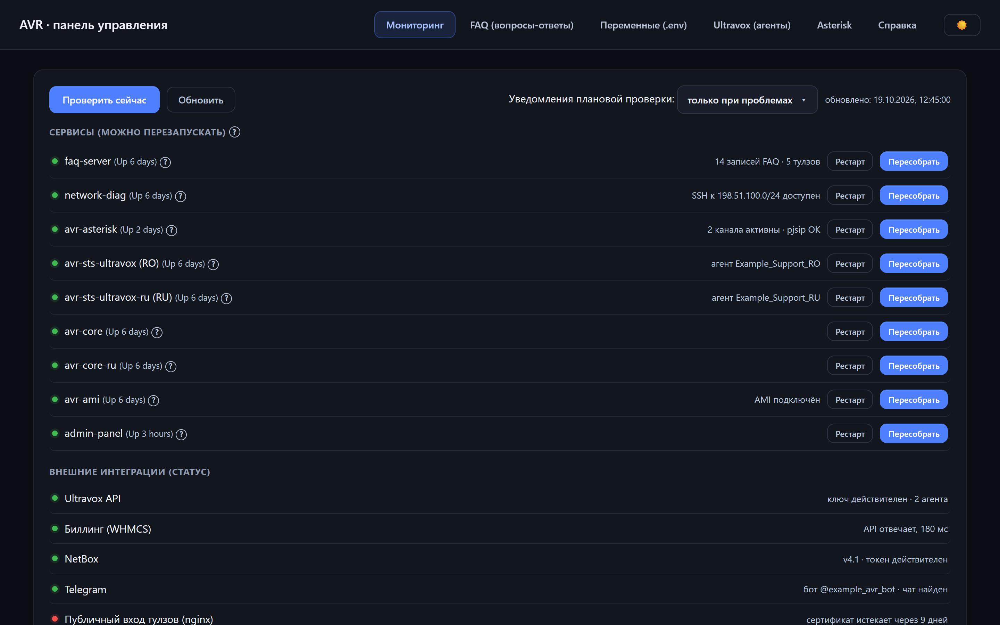
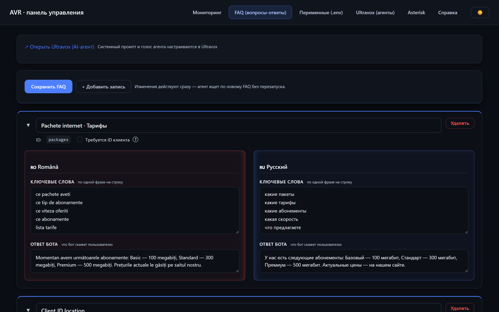
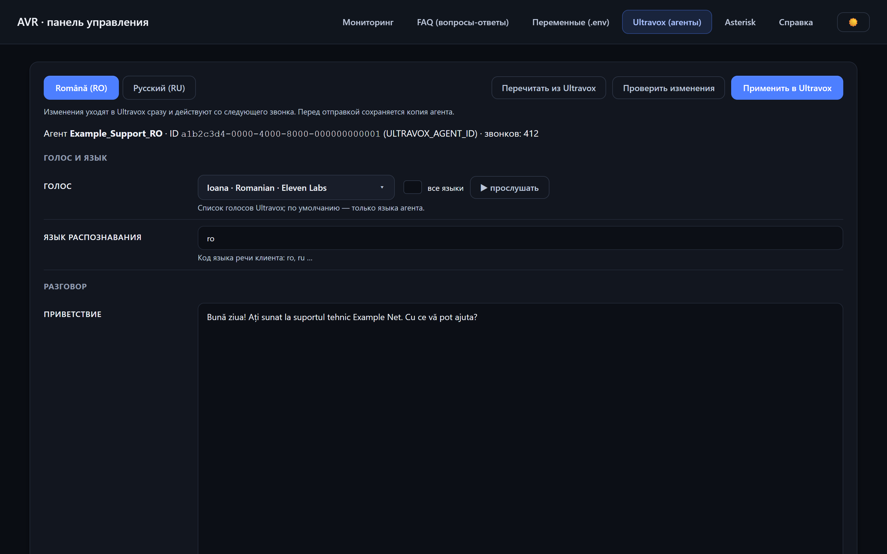
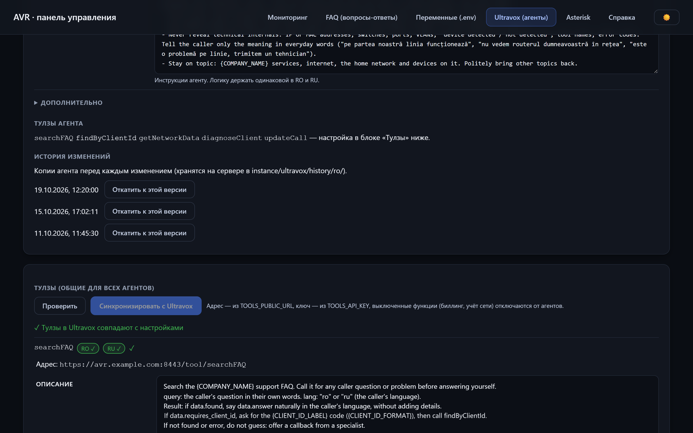
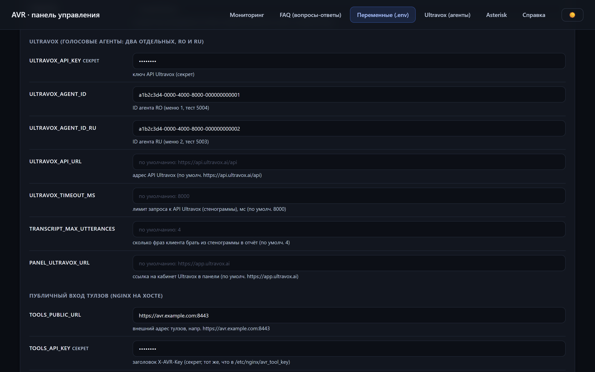
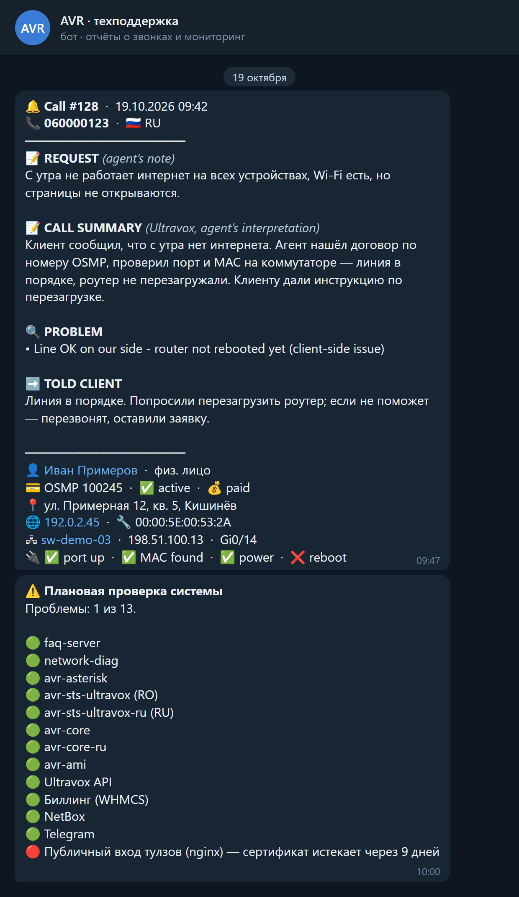
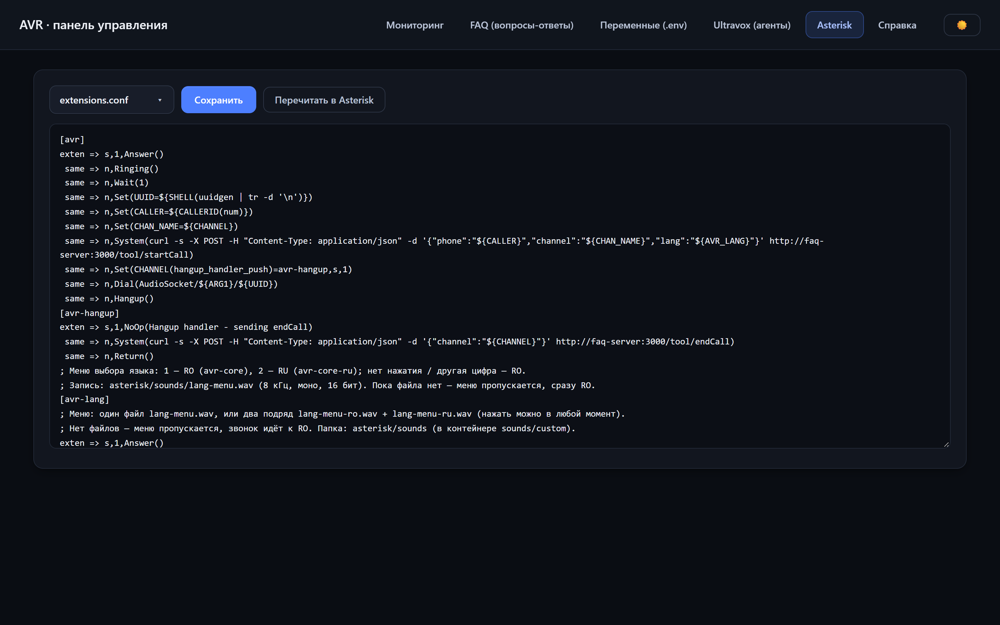
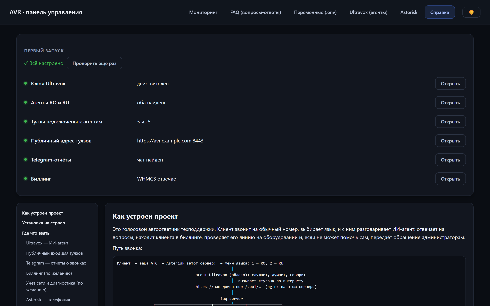
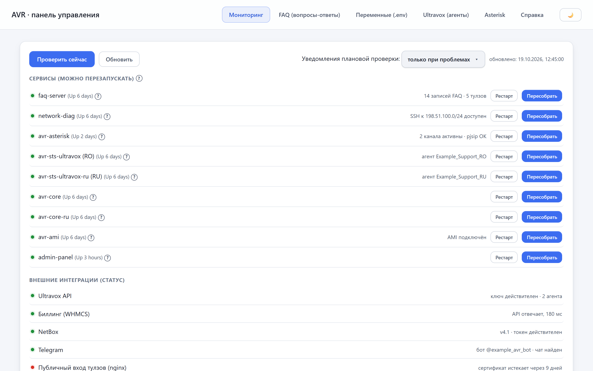

# AI voice agent for ISP technical support

A voice AI agent that answers calls on an ISP's technical support line, handles frequently asked
questions, finds the subscriber in the billing system and diagnoses their connection on the switch
by itself, in Romanian and Russian.

Built on the open-source [Agent Voice Response — avr-infra](https://github.com/agentvoiceresponse/avr-infra)
project (MIT, © Agent Voice Response). Asterisk and the AVR core (Docker images) come from upstream;
everything else in this repository is my own work to make it fit for real-world operation.


<p align="center">
  
</p>

## Screenshots

| | |
|---|---|
|  |  |
| **FAQ:** keywords and answers in RO and RU | **Ultravox agent:** voice, greeting, prompt |
|  |  |
| **Tools** and the agent's change history | **`.env` variables** with descriptions |

<p align="center">
  
</p>
<p align="center"><b>Telegram bot:</b> a report for every call and the result of the scheduled service check
(text built by <code>faq-server/tools/callLogger.js</code> and <code>admin-panel/server.js</code>)</p>

<details>
<summary>Asterisk configs, guide, light theme</summary>

| | |
|---|---|
|  |  |
| **Asterisk configs** | **Guide** and the first-run check |
|  | |
| **Light theme** | |

</details>

All screenshots use demo data: the FAQ, prompts and tools come from this repository; statuses and the
log are made up. All names, domains, IP addresses, phone numbers and identifiers are replaced with
examples (`example.com`, `192.0.2.0/24`, `203.0.113.0/24` and so on).

Admin UI is in Russian for local operators.

---

## What it does

Added on top of AVR:

- **Two Ultravox agents (RO / RU)** and an Asterisk voice menu for choosing the language; prompts live in `ultravox/prompts/`.
- **faq-server** (Node.js): the agent's HTTP tools: FAQ search, client lookup in billing (WHMCS),
  connection data from NetBox, starting diagnostics, a call log and a report on every call to Telegram.
- **network-diag** (Python/Flask): SSH diagnostics of the subscriber's switch: port status, MAC addresses,
  errors; access is limited to the allowed management networks.
- **admin-panel** (Node.js): a web panel for `.env` settings, the FAQ, Ultravox agents, Asterisk,
  service health monitoring, a daily report, password brute-force protection and an audit log.
- **Publishing the tools**: nginx + Let's Encrypt (DNS-01); only the required endpoints are exposed, behind a key.
- **install.sh**: installs on a clean server: Docker, settings with random passwords, ufw, start-up.

## Architecture

```
Caller ─► PBX (FreePBX) ─SIP─► avr-asterisk ─► avr-core ─► avr-sts-ultravox ─► Ultravox Cloud (LLM + voice)
                                                                                  │ tool calls
                                  https://avr.example.com:8443/tool/* (nginx) ◄───┘
                                                  │
                             faq-server ─► billing (WHMCS), NetBox, network-diag ─► switches
                                  └─► Telegram (call report)
```

## Tech stack

Asterisk + AVR core (upstream Docker images) · Ultravox (speech-to-speech) · Node.js 20 / Express
(faq-server, admin-panel) · Python / Flask + Paramiko (network-diag) · nginx + Let's Encrypt ·
Docker Compose · WHMCS · NetBox · Telegram Bot API.

## Quick start

```bash
cp .env.example .env   # fill in the keys
./install.sh --dry-run # see what will be done
./install.sh
```

## Documentation

Detailed docs are in Russian:

- [PROJECT.md](PROJECT.md): architecture, operations, changelog
- [ULTRAVOX.md](ULTRAVOX.md): setting up the agents and tools
- [MIGRATION.md](MIGRATION.md): moving to another server and the pitfalls found along the way
- [PBX_IVR.md](PBX_IVR.md): the language selection voice menu on the PBX

## License

MIT, see [LICENSE.md](LICENSE.md). Original project: © Agent Voice Response.
